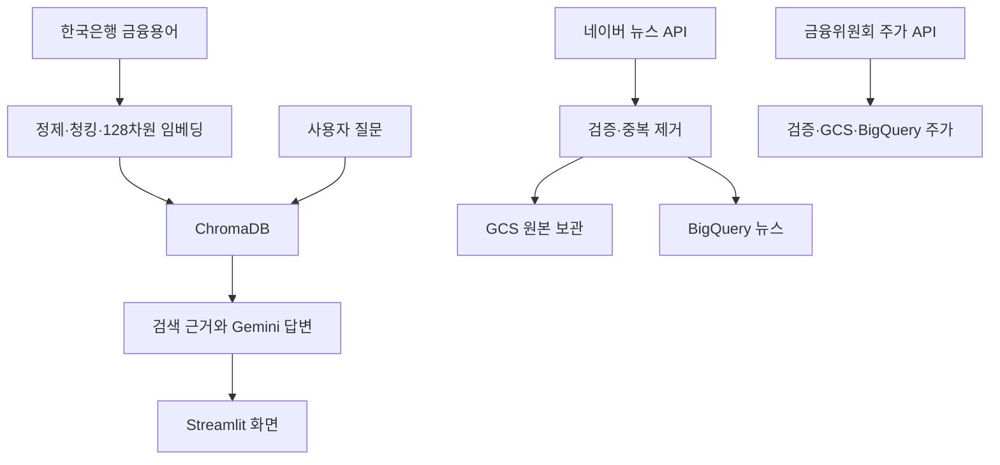

# FinFlow
### 금융 입문자를 위한 근거 기반 금융 지식 검색 서비스

금융 뉴스를 읽다가 낯선 용어를 만나면, 용어를 검색하고 설명을 이해한 뒤 다시 기사로 돌아가야 합니다. FinFlow는 **한국은행 금융용어 검색과 생성형 AI 설명을 연결하고, 관련 뉴스와 주가 데이터를 함께 탐색**할 수 있도록 만드는 개인 프로젝트입니다.

BDAI 데이터 엔지니어링 부트캠프에서 출발했으며, 금융 도메인 데이터 수집·정제와 서비스 확장 과정을 기록합니다. 개발자: **차가원**.

> **현재 공개 범위:** 저장소에는 1·2주차 기반 코드가 있습니다. 이후 FinFlow 앱·뉴스 파이프라인은 개발 기록으로 확인되지만 최신 소스가 아직 반영되지 않았습니다. 아래 구현 이력과 현재 checkout에서 실행 가능한 범위는 구분합니다. 문서 정리 기준: 2026-11-21.

## 해결하려는 문제와 사용 시나리오

대상은 금융용어와 금융 뉴스 해석에 어려움을 겪는 대학생·사회초년생입니다. 사용자 인터뷰를 통해 검증한 수요가 아니라 현재의 문제 가설입니다.

| 상황 | 목표 경험 | 확인된 개발 범위 |
|---|---|---|
| “가계부실위험지수가 뭐야?” | 관련 용어를 찾고 근거와 쉬운 설명 확인 | 금융용어 검색·Gemini RAG 개발 기록 |
| 금융 이슈를 더 알고 싶음 | 관련 뉴스의 제목·요약·원문 링크 확인 | 네이버 뉴스 연동 기록 |
| 특정 종목의 수치를 보고 싶음 | BigQuery에서 저장된 주가 확인 | 300개 종목 조회·BYC 1행 조회 기록 |

저장된 주가는 과거 수집 시점의 표본입니다. 실시간 시세 서비스나 투자 추천 성과를 의미하지 않습니다.

## 구현과 검증 기록

| 구성 | 확인된 결과 | 현재 저장소 |
|---|---|---|
| 주식 시세 ETL | 금융위원회 API → 검증 → GCS → BigQuery, 300건 기록 | 기반 코드 있음 |
| 금융용어 데이터 | 초기 69건에서 PDF 기반 770건으로 확장, BigQuery 770행 확인 | 초기 수집·전처리 코드 있음; PDF 후속 코드 미반영 |
| 임베딩·벡터 검색 | 128차원 모델 사용; 2026-08-01 컬렉션 count 1,121 | 초기 임베딩·검색 코드 있음; 최신 ChromaDB 로더 미반영 |
| 뉴스 파이프라인 | 125건 적재, 동일 입력 재실행 시 신규 0건, 후속 누적 183건 | 후속 코드 미반영 |
| Airflow | 뉴스 수집·검증·GCS·BigQuery DAG 테스트 성공 | 미반영 |
| Streamlit·RAG | 답변·근거 표시 코드, Gemini 연동 및 관련 뉴스 개발 기록 | 미반영 |
| Cloud Run | 앱 revision 배포 및 뉴스 Job 배포 성공 기록 | Dockerfile·배포 설정 미반영 |

이 수치는 당시 개발 환경에서 확인한 결과입니다. 현재 운영 상태, 검색 정확도, 사용자 만족도 또는 응답 속도 측정치는 아닙니다.

## 데이터와 서비스 구조

금융용어는 의미 검색, 숫자는 SQL 조회, 뉴스는 수집·검증·중복 제거 후 보관하는 구조입니다. 모든 흐름의 현재 통합 동작이 검증된 것은 아닙니다.

뉴스 임베딩, 모든 데이터의 통합 질문 라우팅, 운영 로그 분석은 완료 기능으로 표시하지 않습니다.

## 기술 선택

| 기술 | 맡은 역할과 이유 |
|---|---|
| Python·requests | API 수집과 데이터 변환을 단순한 함수로 구성 |
| GCS | 원본 파일과 벡터 스냅샷 보관 |
| BigQuery | 정형 수치·기사 메타데이터 저장과 SQL 검증 |
| sentence-transformers | `kekeappa/kor-static-embedding-128` 기반 임베딩 |
| ChromaDB | 로컬 영속 벡터 검색; 소규모 RAG 구성 |
| Gemini | 검색 근거를 이용한 설명 생성 |
| Streamlit | 핵심 질문·응답 경험을 빠르게 시연 |
| Airflow | 단계별 실행·재시도·실패 위치 확인 |
| Cloud Run·Cloud Build | 앱과 수집 Job의 컨테이너 배포 |

기술별 대안·부담·한계는 [설계 기록](docs/architecture.md)에 정리했습니다.

## 실행 및 시연

**현재 checkout만으로 최신 FinFlow 앱을 실행할 수는 없습니다.** 존재하지 않는 `app.py` 실행 명령을 안내하지 않도록 [실행 안내](docs/reproduction.md)에 현재 가능한 실습과 최신 소스 반영 절차를 구분했습니다.

Cloud Run 앱 배포 주소: https://finflow-app-742422896041.asia-northeast3.run.app  
2026-08-01 배포 기록에서 확인한 주소이며, 현재 접속과 질문·응답 정상 동작은 재검증 전입니다.

## 문서 탐색

- [아키텍처·기술 결정](docs/architecture.md)
- [전체 개발 이력·10단계 진행 현황](docs/development-history.md)
- [평가 조건·결과·한계](docs/evaluation.md)
- [트러블슈팅](docs/troubleshooting.md)
- [실행·재현 안내](docs/reproduction.md)
- [개인 기여·강의 출처·다음 작업](docs/contribution-and-roadmap.md)
- [이전 부트캠프 README](docs/archive/bootcamp-readme.md)

## 다음 우선순위

1. 최신 로컬 FinFlow 소스를 반영하고 비밀 정보·대용량 생성물을 제외합니다.
2. 새로운 환경에서 “질문 → 근거 검색 → 답변” 시나리오 하나를 끝까지 재현합니다.
3. 고정 평가 질문으로 검색 관련성·근거 일치·답변 보류·응답 시간을 측정합니다.

부트캠프에서 시작한 배경과 기존 실습 기록을 유지하며, 직접 확장한 부분의 코드와 검증 근거를 보완합니다.
