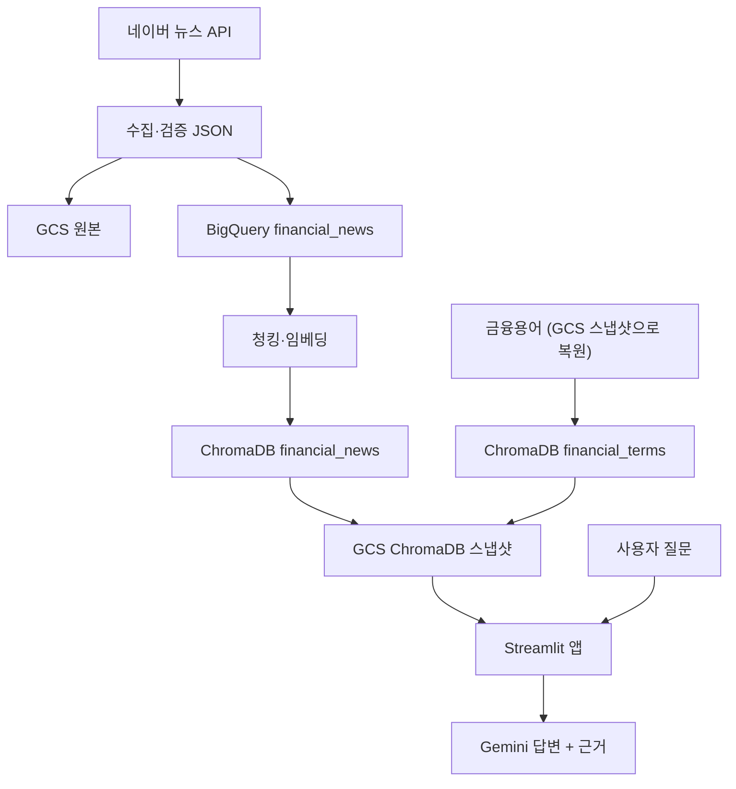

# FinFlow

### 금융 입문자가 용어의 뜻에서 뉴스의 맥락까지 이해하도록 돕는 금융 지식 검색 프로젝트

**차가원 · 개인 프로젝트 · BDAI 데이터 엔지니어링 부트캠프 기반**
Python · GCS · BigQuery · Sentence Transformers · ChromaDB · Gemini · Streamlit

금융 뉴스를 읽다가 낯선 용어를 만나면 사전에서 뜻을 찾고 다시 기사로 돌아가야 합니다. FinFlow는 한국은행 금융용어를 검색 근거로 활용해 쉬운 설명을 제공하고, 관련 뉴스와 저장된 주가를 함께 탐색하는 서비스를 목표로 합니다. 대상 사용자는 대학생·사회초년생이며, 문제와 사용자 가치는 아직 사용자 조사로 검증하기 전의 가설입니다.

**현재 공개 버전:** 최신 FinFlow 앱, 뉴스 파이프라인, Airflow DAG, 배포 설정이 [finflow/](finflow/README.md)에 공개돼 있습니다(2026-11-22 main 반영). 초기 수집·적재·임베딩 실습 코드는 주차별 폴더에 있습니다. 벡터 DB 같은 생성 데이터는 Git에 넣지 않으므로, 앱을 실행하려면 먼저 데이터를 준비해야 합니다.

[FinFlow 앱](finflow/README.md) · [프로젝트 사례 정리](docs/portfolio.md) · [실행 안내](docs/reproduction.md) · [평가 기록](docs/evaluation.md) · [개인 기여와 다음 작업](docs/contribution-and-roadmap.md)

## 현재 상태 (2026-11-22 기준)

| 구분 | 내용 |
|---|---|
| **구현 완료** (코드 공개) | Streamlit 앱(`finflow/app_ui.py`), 금융용어 벡터 검색과 뉴스 하이브리드 검색을 거쳐 Gemini로 답변 생성(`finflow/src/`), 뉴스 수집부터 ChromaDB 스냅샷까지 파이프라인(`finflow/scripts/`), 금융용어 생성 파이프라인(PDF 추출부터 ChromaDB 적재까지, [`finflow/scripts/terms/`](finflow/scripts/terms/README.md)), Airflow DAG, Dockerfile과 Cloud Build 설정, 데이터 준비 상태 판단, 스냅샷 안전 압축 해제 |
| **테스트 완료** (자동 테스트) | `finflow/tests/` 43개 통과. 데이터 준비 상태 판단, 스냅샷 압축 해제 보안, Streamlit 화면(AppTest), 금융용어 생성 파이프라인의 운영 데이터 보호(13개). GCS·BigQuery는 mock을 쓰고 Gemini는 호출하지 않음 |
| **미검증** | Docker 빌드와 실행, 실제 GCS 스냅샷 다운로드, Cloud Run 배포, 질문 제출부터 Gemini 답변까지의 전체 흐름, Airflow scheduler 정기 실행, 검색·답변 품질, 금융용어 BigQuery 실제 적재·조회와 운영 반영(서비스 DB·GCS 스냅샷 교체) |
| **향후 계획** | 홈 화면 고정 수치 제거, 주가 조회의 앱 연결 여부 결정, 고정 질문 평가 세트 |

## 사용자 문제와 핵심 경험

| 사용자 상황 | 목표 동작 | 제공하려는 가치 |
|---|---|---|
| “가계부실위험지수가 뭐야?” | 용어 근거를 검색하고 쉬운 설명과 함께 표시 | 설명을 출처와 함께 확인 |
| 용어가 뉴스에서 어떻게 쓰이는지 궁금함 | 관련 기사 제목·요약·원문 링크 제공 | 개념과 실제 맥락 연결 |
| 특정 종목의 수치를 확인하고 싶음 | 저장된 주가를 SQL로 조회하고 기준일 표시 | 숫자와 설명의 역할 구분 |

핵심 검증 시나리오는 **질문 → 관련 용어 근거 → 쉬운 설명 → 출처 확인**입니다. 공개된 앱 코드는 질문마다 금융용어와 뉴스를 함께 검색합니다. 두 결과를 모두 프롬프트에 넣어 답변을 만들고, 출처를 화면에 표시합니다. 다만 실제 질문을 넣어 답변까지 확인하는 전체 흐름은 아직 검증하지 않았습니다. 주가 조회는 현재 앱에 연결돼 있지 않습니다(실험 코드: `finflow/experiments/stock_pipeline/`).

## 코드에서 확인할 수 있는 작업

| 작업 | 구현과 설계 판단 | 코드 |
|---|---|---|
| 금융 API 수집 | 금융위원회 응답 구조·페이지 수집·API resultCode 검사, 인증키 환경변수 분리 | [주가 수집기](de-bootcamp-week1/scripts/day1_stock_crawler.py) |
| 적재 전 품질 검증 | 레코드 건수·필수 필드·종가와 거래량 숫자 검사 후 적재 | [검증 함수](de-bootcamp-week1/scripts/data_quality.py) · [업로더](de-bootcamp-week1/scripts/day2_upload_stock_to_gcp.py) |
| 원본과 조회 데이터 분리 | GCS 원본 보관, BigQuery 수치 조회와 적재 이력 기록 | [1주차 기록](de-bootcamp-week1/README.md) |
| 임베딩과 의미 검색 | 청크를 벡터화하고 코사인 유사도로 검색 | [임베딩](de-bootcamp-week2/scripts/day2_local_embedding.py) · [금융용어 검색](de-bootcamp-week1/scripts/fin_terms_query.py) |
| RAG 앱 | 질문 분석 → 금융용어 벡터 검색·재정렬 → 뉴스 하이브리드 검색 → Gemini 답변, 근거 표시 | [RAG](finflow/src/rag.py) · [대시보드](finflow/app_ui.py) |
| 뉴스 파이프라인 | 네이버 뉴스 수집 → GCS → BigQuery → 청킹 → 임베딩 → ChromaDB → GCS 스냅샷 | [전체 실행](finflow/scripts/pipelines/run_news_pipeline.py) · [DAG](finflow/dags/naver_news_pipeline_dag.py) |
| 데이터 준비와 안전성 | 두 컬렉션의 존재 여부 검증, GCS 스냅샷 런타임 적용, 안전하지 않은 압축 항목 거부 | [스냅샷](finflow/src/news_snapshot.py) · [테스트](finflow/tests/) |

현재 주가 수집기의 수집 직후 검증 호출은 주석 처리되어 있고, 업로더에서 검증합니다. 주가 적재는 `WRITE_APPEND`이며 재실행 중복 방지가 구현됐다고 주장하지 않습니다. 페르소나 검색 CLI와 금융용어 검색 CLI는 입력 형식이 다릅니다.

## 확장 이력과 확인 수준

다음은 기존 개발 문서에 정리된 과거 실행 기록입니다. 이번 문서 정리에서 클라우드 조회나 앱 E2E를 재실행한 결과가 아닙니다.

| 개발 이력 | 기록된 결과 | 현재 공개 코드 상태 |
|---|---|---|
| 금융용어 확장 | 초기 69건 → PDF 기반 770건, BigQuery 770행 | PDF 추출·파서·정제·BigQuery 적재 코드 반영([`finflow/scripts/terms/`](finflow/scripts/terms/README.md)). 2026-11-23 로컬 재현에서 용어 770건이 기존 결과물과 같음. BigQuery 실제 적재·조회는 미검증 |
| 금융용어 벡터 검색 | 2026-08-01 ChromaDB count 1,121 | 검색 코드 반영(`finflow/src/retriever.py`). 청킹·임베딩·컬렉션 생성 코드 반영(`finflow/scripts/terms/`). 2026-11-23 로컬 재현에서 1,121청크가 기존 컬렉션과 ID·본문 일치. 서비스 데이터는 지금도 GCS 스냅샷으로 복원하며 운영 반영은 미검증 |
| 뉴스 수집·중복 처리 | 최초 125건, 동일 입력 재실행 신규 0건, 후속 누적 183건 | 수집·적재·청킹·임베딩·적재 코드 반영(`finflow/scripts/`). 수치는 재측정하지 않음 |
| 자동화와 서비스 | 뉴스 DAG 테스트·Streamlit RAG·Cloud Run 배포 기록 | 앱·DAG·Dockerfile·Cloud Build 설정 반영. 컨테이너 빌드와 Cloud Run은 미검증 |

데이터 건수는 검색 정확도나 사용자 효과를 의미하지 않습니다. 실행 조건과 수치별 한계는 [평가 기록](docs/evaluation.md), 변화 과정은 [개발 이력](docs/development-history.md)에 정리했습니다.

## 구조와 기술 선택

FinFlow 앱과 뉴스 파이프라인의 데이터 흐름입니다([finflow/](finflow/README.md)).



초기 실습 코드(주차별 폴더)의 흐름은 다음과 같습니다. 주가 API → 검증 → GCS 원본 → BigQuery 시세로 이어지고, 텍스트 청크 → 로컬 임베딩 JSON → 코사인 유사도 검색으로 이어집니다.

- **GCS / BigQuery:** 원본 재처리와 정형 데이터 SQL 조회의 역할을 분리합니다.
- **ChromaDB:** 금융용어와 뉴스 두 컬렉션을 의미 검색에 씁니다. 앱은 두 컬렉션이 모두 있어야 검색을 허용합니다.
- **Streamlit / Gemini:** 질문 분석, 재정렬, 근거 기반 답변을 화면에 보여 줍니다.
- **Airflow / Cloud Run Job:** DAG는 수집 → 검증 → GCS → BigQuery를 실행합니다. Cloud Run Job용 파이프라인은 ChromaDB 스냅샷 갱신까지 실행합니다. 두 경로의 장기 자동 운영은 검증 전입니다.

대안과 운영 부담은 [아키텍처·기술 결정](docs/architecture.md)을 참고하세요.

## 실행과 시연

처음 실행하는 경우 [실행·재현 안내](docs/reproduction.md)와 [FinFlow 앱 안내](finflow/README.md)를 확인하세요. 앱은 clone 후 의존성을 설치하고 ChromaDB 데이터를 준비하면 실행할 수 있습니다. 데이터는 GCS 스냅샷으로 받으며 GCS 읽기 권한이 필요합니다. 데이터가 없으면 앱이 준비 방법을 안내합니다.

```bash
cd finflow
python -m pip install -r requirements-dev.txt
cp .env.example .env                                   # 값 채우기
python scripts/vectorstores/download_chroma_snapshot.py  # GCS 권한 필요
streamlit run app_ui.py
python -m pytest tests -v                              # 자동 테스트 (데이터·인증 불필요)
```

[과거 Cloud Run 배포 주소](https://finflow-app-742422896041.asia-northeast3.run.app)는 2026-08-01 기록의 주소입니다. 현재 가용성과 질문·응답은 재검증 전이며 검증된 라이브 데모로 표시하지 않습니다.

## 다음 검증 목표

1. 공개된 `finflow/` 소스로 새 환경과 컨테이너에서 핵심 시나리오(질문 → 근거 → 답변)를 재현합니다.
2. 고정 질문 15~20개로 관련 근거 top-5 포함 여부, 답변·근거 일치, 모호한 질문과 근거 부족 대응을 평가합니다.
3. 같은 데이터·모델·질문 조건에서 한 가지 변경의 효과와 응답 시간을 비교합니다.

## 문서와 학습 기록

| 읽는 목적 | 문서 |
|---|---|
| 앱 실행·데이터 준비·테스트·배포 설정 | [FinFlow 앱](finflow/README.md) |
| 문제·선택·기여·한계를 한 번에 확인 | [포트폴리오 사례](docs/portfolio.md) |
| 데이터 흐름과 기술 선택 | [아키텍처](docs/architecture.md) |
| 재현과 설정 | [실행 안내](docs/reproduction.md) |
| 측정 결과와 평가 계획 | [평가 기록](docs/evaluation.md) |
| 실패 원인과 조치 | [트러블슈팅](docs/troubleshooting.md) |
| 직접 확장한 부분과 출처 | [개인 기여](docs/contribution-and-roadmap.md) |
| 과거 과정과 원문 기록 | [개발 이력](docs/development-history.md) · [이전 README](docs/archive/bootcamp-readme.md) |
| 기반 실습 | [1주차](de-bootcamp-week1/README.md) · [2주차](de-bootcamp-week2/README.md) |

부트캠프 기반 구조와 개인 금융 도메인 확장을 구분합니다. AI 도구 도움과 직접 수행 범위는 실제 작업 내역에 맞춰 설명하며, 확인되지 않은 정확도·비용 절감·사용자 수를 성과로 기재하지 않습니다.
