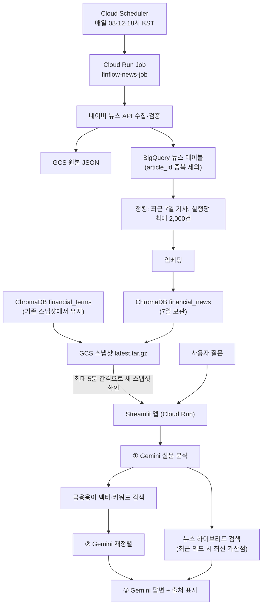

# FinFlow

### 금융 입문자가 용어의 뜻에서 뉴스의 맥락까지 한 번에 이해하도록 돕는 금융 지식 검색 서비스

**차가원 · 개인 프로젝트**
Python · GCS · BigQuery · Sentence Transformers · ChromaDB · Gemini · Streamlit · Cloud Run

## 1. 해결하려는 문제와 핵심 기능

금융 뉴스를 읽다가 낯선 용어를 만나면 사전에서 뜻을 찾고 다시 기사로 돌아가야 합니다. FinFlow에 질문하면 한국은행 금융용어를 근거로 한 쉬운 설명과, 그 용어가 쓰인 최근 뉴스를 출처와 함께 한 화면에서 볼 수 있습니다. 대상 사용자는 대학생과 사회초년생입니다. 이 문제와 사용자 가치는 아직 사용자 조사로 검증하지 않은 가설입니다.

| 사용자 상황 | FinFlow의 동작 |
|---|---|
| “가계부실위험지수가 뭐야?” | 금융용어 근거를 검색해 쉬운 설명과 함께 표시 |
| 용어가 뉴스에서 어떻게 쓰이는지 궁금함 | 최근 7일 기사 중 관련 기사의 제목·요약·원문 링크를 표시 |
| 답변을 믿어도 되는지 확인하고 싶음 | 답변에 쓴 금융용어와 기사를 출처로 함께 표시 |

“최근”, “오늘”처럼 최신 정보를 묻는 질문에서는 최근 기사가 앞에 오도록 순위를 보정합니다. 주가 조회는 실험 코드(`finflow/experiments/stock_pipeline/`)만 있고 앱에는 연결하지 않았습니다.

## 2. 현재 서비스와 리디자인 화면

**서비스 URL:** https://finflow-app-742422896041.asia-northeast3.run.app

2026-11-26 기준 Cloud Run 리비전 `finflow-app-00014-kos`(main `a09b759`)가 트래픽 100%를 받고 있습니다. 질문 하나에 Gemini API를 3번 호출하므로, 공개 URL로 질문하면 API 사용량이 발생합니다.


1400px 화면에서 고정 예시 질문과 고정 예시 답변으로 렌더링한 캡처입니다. 실제 Gemini 응답을 캡처한 화면이 아닙니다. 리디자인 전후 비교와 900px·390px 화면은 [PR #11](https://github.com/gawounnx/finflow/pull/11)에 있습니다.

## 3. 실제 데이터 흐름



- **역할 분리:** GCS에 원본을 보관하고, BigQuery로 정형 조회와 중복 제외를 처리합니다. ChromaDB는 의미 검색에, GCS 스냅샷은 앱과 Job 사이의 데이터 전달에 씁니다.
- **안전 장치:** 스냅샷은 두 컬렉션이 모두 있고 비어 있지 않을 때만 업로드합니다. 내려받을 때는 경로 탈출과 링크 항목을 거부하고, 검증에 실패하면 기존 데이터를 그대로 둡니다.
- **금융용어:** 앱은 GCS 스냅샷에 있는 금융용어 컬렉션을 씁니다. PDF 파싱부터 컬렉션 생성까지의 스크립트는 [PR #6](https://github.com/gawounnx/finflow/pull/6)에서 정리 중이며 아직 main에 없습니다.
- **Airflow DAG**(`finflow/dags/`)에는 수집 → 검증 → GCS → BigQuery 경로가 있습니다. 운영 정기 실행은 위의 Cloud Scheduler와 Cloud Run Job이 맡습니다.

설계 대안과 운영 부담은 [아키텍처·기술 결정](docs/architecture.md)에 정리했습니다.

## 4. 확인된 구현·검증 결과와 남은 한계

아래는 PR 기록과 배포 기록으로 확인되는 내용입니다. 검색 정확도와 사용자 효과는 아직 측정하지 않았으므로 성과로 적지 않습니다.

| 구분 | 확인 내용 | 근거 |
|---|---|---|
| 배포 | Cloud Build로 이미지를 만들고, 트래픽 0% 태그 URL에서 검증한 뒤 전환. 현재 `finflow-app-00014-kos`가 100%, 이전 리비전은 롤백용으로 보관 | 2026-11-26 배포 기록 |
| 배포 앱의 Gemini 전체 흐름 | 운영 앱(리비전 `00010-buq`)에서 실제 질문 1건을 제출. 오류 없이 답변했고, 인용한 기사 3건이 모두 스냅샷에 있으며 원문 링크가 응답함. 배포 전 로컬 검증에서는 Gemini 호출 3회가 모두 200 | 2026-11-26 배포 기록, [PR #9](https://github.com/gawounnx/finflow/pull/9) |
| 뉴스 정기 갱신 | 메모리 초과로 멈췄던 뉴스 Job을 7일 증분 처리로 복구. 11/26 Job 실행 2회 성공, Scheduler 하루 3회 운영 중 | [PR #5](https://github.com/gawounnx/finflow/pull/5), Cloud Run Job 실행 이력 |
| 앱 수정 | 첫 스냅샷 즉시 확인, 검색 폼 제출, 실패 시 이전 답변 제거, 갱신 상태를 운영 일정 기준으로 표시 | [PR #8](https://github.com/gawounnx/finflow/pull/8), [PR #10](https://github.com/gawounnx/finflow/pull/10) |
| 리디자인 | Chrome 900px·390px에서 가로 넘침 없음. 배포 후 운영 URL에서 새 화면과 갱신 표시 확인(이때는 Gemini 호출 없음) | [PR #11](https://github.com/gawounnx/finflow/pull/11) |
| 자동 테스트 | 오프라인 테스트 185개 통과(Streamlit 1.67). GCS·BigQuery·Gemini는 mock이나 가짜 응답으로 대체. 회귀 테스트가 수정 전 코드에서 실패하는 것도 확인 | PR #11 최종 커밋 `1b3df82` 기록 |

테스트 개수는 코드 경로를 확인한 범위일 뿐, 답변 품질을 나타내지 않습니다.

**남은 한계**

- 검색·답변 품질은 정량 평가 전입니다. 운영 앱에서 실제 Gemini로 확인한 질문은 1건입니다.
- 관련 뉴스가 없을 때 “없다”고 안내하는지는 실제 Gemini로 확인하지 못했습니다.
- 제목에 검색 키워드가 모두 들어간 옛 기사는 “최근” 질문에서도 앞설 수 있습니다.
- 11/23~11/25 뉴스는 Scheduler가 멈춰 있던 기간이라 비어 있습니다.
- 금융용어 생성 스크립트는 main에 아직 없습니다(PR #6).

## 5. 실행 방법

앱은 clone 후 의존성을 설치하고 ChromaDB 데이터를 준비하면 로컬에서 실행할 수 있습니다. 데이터는 GCS 스냅샷으로 받으므로 GCS 읽기 권한이 필요합니다. 데이터가 없으면 앱이 준비 방법을 안내합니다.

```bash
cd finflow
python -m pip install -r requirements-dev.txt
cp .env.example .env                                     # 값 채우기
python scripts/vectorstores/download_chroma_snapshot.py  # GCS 권한 필요
streamlit run app_ui.py
python -m pytest tests -q                                # 자동 테스트 (데이터·인증·Gemini 키 불필요)
```

환경 변수, 데이터 준비, 컨테이너 빌드와 배포 설정은 [FinFlow 앱 안내](finflow/README.md)와 [실행·재현 안내](docs/reproduction.md)에 있습니다.

## 6. 개발 범위와 개인 기여

FinFlow는 차가원이 금융 입문자의 질문과 근거 확인 경험을 중심으로 기획·개발·운영하는 개인 프로젝트입니다. 초기 수집·적재·임베딩 구조는 BDAI 데이터 엔지니어링 부트캠프 실습에서 출발했고, 실습 코드는 [1주차](de-bootcamp-week1/README.md)·[2주차](de-bootcamp-week2/README.md) 폴더에 있습니다.

| 영역 | 수행한 작업 | 관련 코드와 기록 |
|---|---|---|
| 금융 지식 검색 | 한국은행 금융용어를 근거로 검색하고, Gemini로 질문 분석·재정렬·답변 생성 | [finflow/src/](finflow/src/) · [개발 이력](docs/development-history.md) |
| 뉴스 연계 | 금융 뉴스 하이브리드 검색, 최근 소식 의도에 따른 순위 보정, 기사 날짜·원문 링크 표시 | [뉴스 검색](finflow/src/news_retriever.py) · [RAG](finflow/src/rag.py) |
| 사용자 화면 | 검색 폼, 답변과 출처 표시, 모바일 화면, 실패 시 이전 답변 제거, 갱신 상태 안내 | [사용자 화면](finflow/app_ui.py) · [스타일](finflow/styles/main.css) |
| 데이터 운영 | 뉴스 수집부터 스냅샷 게시까지의 파이프라인, 7일 증분 처리, 안전한 스냅샷 교체 | [finflow/scripts/](finflow/scripts/) |
| 배포·검증 | Cloud Build와 Cloud Run 배포, 태그 URL 확인 후 트래픽 전환, 회귀 테스트와 브라우저 검증 | [앱 안내](finflow/README.md) · [테스트](finflow/tests/) |

AI 도구의 도움과 직접 수행한 범위는 실제 작업 내역에 맞춰 설명합니다. 참고 자료와 세부 기여 범위는 [개인 기여와 다음 작업](docs/contribution-and-roadmap.md)에 정리했습니다.

## 다음 검증 목표

1. 고정 질문 15~20개로 관련 근거 top-5 포함 여부, 답변과 근거의 일치, 모호한 질문과 근거가 부족한 질문의 처리를 평가합니다.
2. 같은 데이터·모델·질문 조건에서 한 가지씩 바꿔 효과와 응답 시간을 비교합니다.
3. 금융용어 생성 스크립트(PR #6)를 main에 반영해 데이터를 처음부터 재현할 수 있게 합니다.

## 문서

| 읽는 목적 | 문서 |
|---|---|
| 앱 실행·데이터 준비·테스트·배포 설정 | [FinFlow 앱](finflow/README.md) |
| 문제·선택·기여·한계를 한 번에 확인 | [포트폴리오 사례](docs/portfolio.md) |
| 데이터 흐름과 기술 선택 | [아키텍처](docs/architecture.md) |
| 재현과 설정 | [실행 안내](docs/reproduction.md) |
| 측정 결과와 평가 계획 | [평가 기록](docs/evaluation.md) |
| 실패 원인과 조치 | [트러블슈팅](docs/troubleshooting.md) |
| 직접 확장한 부분과 출처 | [개인 기여](docs/contribution-and-roadmap.md) |
| 과거 과정과 원문 기록 | [개발 이력](docs/development-history.md) |
