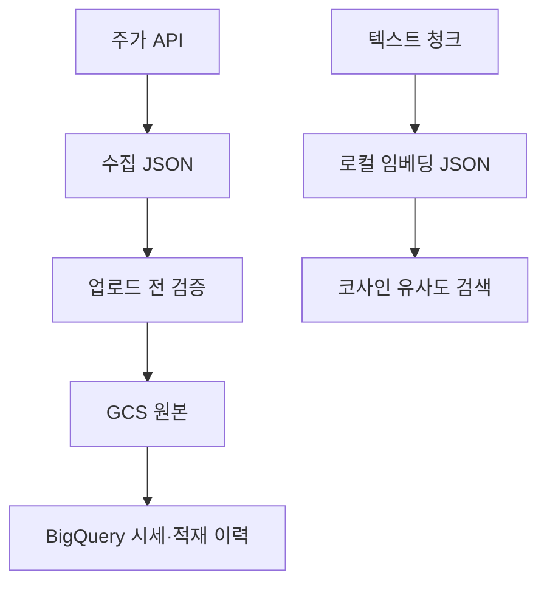

# FinFlow

### 금융 입문자가 용어의 뜻에서 뉴스의 맥락까지 이해하도록 돕는 금융 지식 검색 프로젝트

**차가원 · 개인 프로젝트 · BDAI 데이터 엔지니어링 부트캠프 기반**
Python · GCS · BigQuery · Sentence Transformers · ChromaDB · Gemini · Streamlit

금융 뉴스를 읽다가 낯선 용어를 만나면 사전에서 뜻을 찾고 다시 기사로 돌아가야 합니다. FinFlow는 한국은행 금융용어를 검색 근거로 활용해 쉬운 설명을 제공하고, 관련 뉴스와 저장된 주가를 함께 탐색하는 서비스를 목표로 합니다. 대상 사용자는 대학생·사회초년생이며, 문제와 사용자 가치는 아직 사용자 조사로 검증하기 전의 가설입니다.

**현재 공개 버전:** 이 저장소에서 검토 가능한 코드는 초기 수집·적재·전처리·임베딩·검색입니다. 최신 RAG 앱·뉴스 파이프라인·배포 소스는 아직 반영되지 않았습니다. 아래 개발 이력은 현재 checkout의 실행 보장을 뜻하지 않습니다.

[프로젝트 사례 정리](docs/portfolio.md) · [실행 안내](docs/reproduction.md) · [평가 기록](docs/evaluation.md) · [개인 기여와 다음 작업](docs/contribution-and-roadmap.md)

## 사용자 문제와 핵심 경험

| 사용자 상황 | 목표 동작 | 제공하려는 가치 |
|---|---|---|
| “가계부실위험지수가 뭐야?” | 용어 근거를 검색하고 쉬운 설명과 함께 표시 | 설명을 출처와 함께 확인 |
| 용어가 뉴스에서 어떻게 쓰이는지 궁금함 | 관련 기사 제목·요약·원문 링크 제공 | 개념과 실제 맥락 연결 |
| 특정 종목의 수치를 확인하고 싶음 | 저장된 주가를 SQL로 조회하고 기준일 표시 | 숫자와 설명의 역할 구분 |

핵심 검증 시나리오는 **질문 → 관련 용어 근거 → 쉬운 설명 → 출처 확인**입니다. 뉴스는 최신 앱 확인 전까지 답변 생성의 근거로 통합됐다고 표시하지 않습니다.

## 코드에서 확인할 수 있는 작업

| 작업 | 구현과 설계 판단 | 코드 |
|---|---|---|
| 금융 API 수집 | 금융위원회 응답 구조·페이지 수집·API resultCode 검사, 인증키 환경변수 분리 | [주가 수집기](de-bootcamp-week1/scripts/day1_stock_crawler.py) |
| 적재 전 품질 검증 | 레코드 건수·필수 필드·종가와 거래량 숫자 검사 후 적재 | [검증 함수](de-bootcamp-week1/scripts/data_quality.py) · [업로더](de-bootcamp-week1/scripts/day2_upload_stock_to_gcp.py) |
| 원본과 조회 데이터 분리 | GCS 원본 보관, BigQuery 수치 조회와 적재 이력 기록 | [1주차 기록](de-bootcamp-week1/README.md) |
| 임베딩과 의미 검색 | 청크를 벡터화하고 코사인 유사도로 검색 | [임베딩](de-bootcamp-week2/scripts/day2_local_embedding.py) · [금융용어 검색](de-bootcamp-week1/scripts/fin_terms_query.py) |

현재 주가 수집기의 수집 직후 검증 호출은 주석 처리되어 있고, 업로더에서 검증합니다. 주가 적재는 `WRITE_APPEND`이며 재실행 중복 방지가 구현됐다고 주장하지 않습니다. 페르소나 검색 CLI와 금융용어 검색 CLI는 입력 형식이 다릅니다.

## 확장 이력과 확인 수준

다음은 기존 개발 문서에 정리된 과거 실행 기록입니다. 이번 문서 정리에서 클라우드 조회나 앱 E2E를 재실행한 결과가 아닙니다.

| 개발 이력 | 기록된 결과 | 현재 공개 코드의 한계 |
|---|---|---|
| 금융용어 확장 | 초기 69건 → PDF 기반 770건, BigQuery 770행 | 최종 PDF 파서 미반영 |
| 금융용어 벡터 검색 | 2026-08-01 ChromaDB count 1,121 | 최종 로더·데이터 스냅샷 미반영 |
| 뉴스 수집·중복 처리 | 최초 125건, 동일 입력 재실행 신규 0건, 후속 누적 183건 | 후속 수집·적재 코드 미반영 |
| 자동화와 서비스 | 뉴스 DAG 테스트·Streamlit RAG·Cloud Run 배포 기록 | 최신 앱·DAG·배포 설정 미반영 |

데이터 건수는 검색 정확도나 사용자 효과를 의미하지 않습니다. 실행 조건과 수치별 한계는 [평가 기록](docs/evaluation.md), 변화 과정은 [개발 이력](docs/development-history.md)에 정리했습니다.

## 구조와 기술 선택

현재 공개된 기반 코드의 데이터 흐름입니다.

- **GCS / BigQuery:** 원본 재처리와 정형 데이터 SQL 조회의 역할을 분리합니다.
- **로컬 임베딩 / ChromaDB:** 의미 검색을 구성합니다. 현재 공개 검색 CLI는 JSON 벡터를 직접 비교하며, ChromaDB 통합은 후속 개발 이력입니다.
- **Streamlit / Gemini:** 근거와 쉬운 설명을 빠르게 시연하는 후속 앱 구성입니다.
- **Airflow / Cloud Run:** 배치 의존성·실행 이력과 컨테이너 배포를 다룬 확장입니다. 장기 자동 운영은 검증 전입니다.

대안과 운영 부담은 [아키텍처·기술 결정](docs/architecture.md)을 참고하세요.

## 실행과 시연

처음 실행하는 경우 [실행·재현 안내](docs/reproduction.md)에서 환경과 현재 실행 가능한 범위를 확인하세요. 현재 checkout만으로 최신 웹 앱을 실행할 수는 없습니다.

[과거 Cloud Run 배포 주소](https://finflow-app-742422896041.asia-northeast3.run.app)는 2026-08-01 기록의 주소입니다. 현재 가용성과 질문·응답은 재검증 전이며 검증된 라이브 데모로 표시하지 않습니다.

## 다음 검증 목표

1. 최신 로컬 소스와 실제 설정 예제를 반영해 새 환경에서 핵심 시나리오를 재현합니다.
2. 고정 질문 15~20개로 관련 근거 top-5 포함 여부, 답변·근거 일치, 모호한 질문과 근거 부족 대응을 평가합니다.
3. 같은 데이터·모델·질문 조건에서 한 가지 변경의 효과와 응답 시간을 비교합니다.

## 문서와 학습 기록

| 읽는 목적 | 문서 |
|---|---|
| 문제·선택·기여·한계를 한 번에 확인 | [포트폴리오 사례](docs/portfolio.md) |
| 데이터 흐름과 기술 선택 | [아키텍처](docs/architecture.md) |
| 재현과 설정 | [실행 안내](docs/reproduction.md) |
| 측정 결과와 평가 계획 | [평가 기록](docs/evaluation.md) |
| 실패 원인과 조치 | [트러블슈팅](docs/troubleshooting.md) |
| 직접 확장한 부분과 출처 | [개인 기여](docs/contribution-and-roadmap.md) |
| 과거 과정과 원문 기록 | [개발 이력](docs/development-history.md) · [이전 README](docs/archive/bootcamp-readme.md) |
| 기반 실습 | [1주차](de-bootcamp-week1/README.md) · [2주차](de-bootcamp-week2/README.md) |

부트캠프 기반 구조와 개인 금융 도메인 확장을 구분합니다. AI 도구 도움과 직접 수행 범위는 실제 작업 내역에 맞춰 설명하며, 확인되지 않은 정확도·비용 절감·사용자 수를 성과로 기재하지 않습니다.
