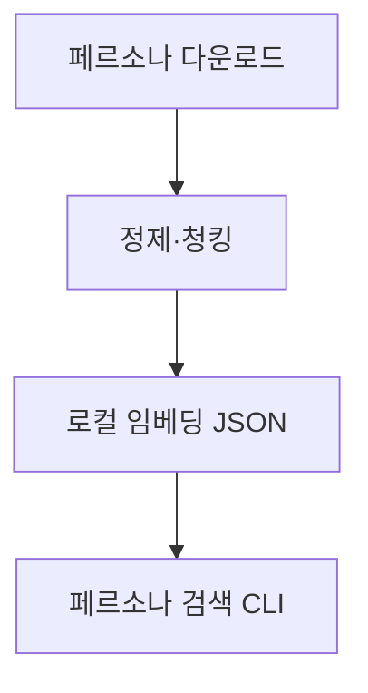

# Week 2 — 텍스트 전처리 · 청킹 · 임베딩

HuggingFace 페르소나 데이터를 수집하고, 청킹 후 SentenceTransformer로 벡터화합니다.
FinFlow AI에서는 금융용어 데이터에 동일한 파이프라인을 적용합니다.

> 초기 실습 기록입니다. 현재 실행 파이프라인은 페르소나 전용이며 금융용어 데이터로 바로 대체할 수 없습니다. 후속 앱과 최종 금융용어 파서는 [공개 범위](../README.md)에서 구분합니다.

## 전체 파이프라인 흐름



금융용어의 초기 69건 → 292청크와 검색 성공은 과거 실험 기록입니다. 현재 공개된 금융용어 검색기는 `de-bootcamp-week1/scripts/fin_terms_query.py`이며 각 입력 레코드에 `term`, `text`, `embedding`이 필요합니다. 페르소나 검색기는 나이·성별·직업 등 별도 메타데이터를 요구합니다.

---

## 부트캠프 실습 코드 → FinFlow AI 대응

수업에서 배운 함수를 버리는 게 아니라, **데이터별 필드와 입력 계약을 확인한 뒤 구조를 재사용**합니다.

| 부트캠프 함수 | FinFlow 함수 | 재사용 여부 |
|--------------|-------------|------------|
| `build_persona_text()` | `build_financial_summary()` | 구조 재사용, 필드만 교체 |
| `extract_metadata()` | 기업명·종목코드·기준연도 추출 | 구조 재사용 |
| `chunk_text()` | 그대로 재사용 | ✅ 그대로 |
| `save_json()` | 그대로 재사용 | ✅ 그대로 |
| 품질 검증 | 그대로 재사용 | ✅ 그대로 |

---

## FinFlow AI 데이터별 처리 방식

### 금융용어 → ChromaDB glossary

용어 정의가 이미 텍스트 형태라 바로 청킹·임베딩 가능합니다.

```json
// 입력
{"term": "PER", "definition": "주가를 주당순이익으로 나눈 값"}

// 청킹 후 ChromaDB 저장
{
  "chunk_id": "fin_term_142_chunk_0",
  "text": "PER: 주가를 주당순이익으로 나눈 값입니다...",
  "metadata": {"collection": "glossary", "term": "PER"}
}
```

가능한 질문:
- PER이 뭐야?
- 채권시가평가란?
- 환율제도의 종류를 알려줘.

### 기업재무정보 → BigQuery + ChromaDB financial_summaries (확장 아이디어·구현 확인 전)

정확한 수치 비교·집계는 SQL 조회를 기준으로 삼습니다.
**숫자 → 설명 문장 변환 후 임베딩**은 탐색 보조를 위한 확장 아이디어이며 효과는 검증 전입니다.

```python
# 원본 숫자 → BigQuery 저장 (SQL 조회용)
{"corpNm": "삼성전자", "revenue": 300000000000000}

# 설명 문장으로 변환 → ChromaDB 저장 (의미 검색용)
"삼성전자의 2025년 매출액은 300조 원이고, 영업이익은 25조 원입니다."
```

가능한 질문:
- 삼성전자 최근 실적 어때?
- 영업이익이 높은 기업은 어디야?
- 부채가 적은 IT 기업을 알려줘.

---

## 청킹 전략 실험 기록

**관찰: 청킹 변경 후 특정 질문의 검색 결과가 달라졌음**

| 방식 | 청크 수 | ETF 검색 결과 |
|------|---------|--------------|
| 용어 1개 = 청크 1개 | 69개 | 검색 실패 기록 (원인 분리 실험 없음) |
| 150자 단위 분할 | 292개 | 검색 성공 기록 (전체 정확도 미측정) |

→ 단일 질문의 관찰이며 청킹만이 원인이라고 단정할 수 없습니다. 동일 데이터·질문·모델 조건에서 다시 비교해야 합니다.
→ 짧은 정의는 용어 단위를 보존하는 방식을 기준선으로 두고, 긴 설명의 분할 효과를 비교합니다.

---

## 스크립트 설명

| 파일 | 역할 |
|------|------|
| `day0_download_personas.py` | HuggingFace에서 페르소나 데이터 20건 다운로드 |
| `day1_preprocess_chunk.py` | 페르소나 텍스트 청킹 (220청크 생성) |
| `day2_local_embedding.py` | SentenceTransformer로 청크 임베딩 (dim=128) |
| `day3_query.py` | 코사인 유사도 기반 쿼리 검색 |
| `run_pipeline.sh` | 수집 → 청킹 → 임베딩 자동 실행 |

**FinFlow AI 추가 스크립트 (de-bootcamp-week1/scripts/):**

| 파일 | 역할 |
|------|------|
| `fin_terms_query.py` | 금융용어 임베딩 기반 의미 검색 |

---

## 실행 방법

```bash
# 저장소 루트에서 시작
cd de-bootcamp-week2
uv venv
source .venv/bin/activate
uv pip install --torch-backend cpu -r scripts/requirements.txt

# 전체 파이프라인 (수집 + 청킹 + 임베딩)
DOWNLOAD_LIMIT=20 bash scripts/run_pipeline.sh

# 임베딩만 다시 생성할 때
python scripts/day2_local_embedding.py \
  --input data/chunks.json \
  --output data/embeddings.json \
  --batch-size 16

# 쿼리
python scripts/day3_query.py --query "부산 사는 60대 남성" --top-k 3
```

---

## 검증 Q&A 10개 (과제 제출용)

아래는 데이터 표현과 가까운 질문으로 확인한 과거 검색 사례입니다. 일반화된 정확도 평가가 아니며, 후속 평가에는 바꿔 말한 질문·모호한 질문·근거 없는 질문도 포함합니다.

| Q | A (chunk_id) |
|---|---|
| 33세 여성 경리 사무원 인천 연수구 | `250145caa9b74e4aaf073d559a61614e_chunk_0` |
| 31세 남성 강구조물 가공원 경북 영주 | `20df908dd5f74569b5d84158c9298a03_chunk_0` |
| 콜센터 상담원 원주시 40대 | `2c30571d3af64e19baac9135d37c31f6_chunk_1` |
| 부산 남구 고성호 영업원 | `fdfc8a5857b4444d9ff64eac5ecbef13_chunk_0` |
| 부산 사는 60대 남성 | `fdfc8a5857b4444d9ff64eac5ecbef13_chunk_0` |
| 파주 e스포츠 청년 피부관리 20대 | `9d3c430b17ee480aab5936c27724a7e1_chunk_0` |
| 마포구 26세 디지털 취향 청년 | `9012f5e074224c5f9e6bc4f225fce213_chunk_0` |
| 분당 언론학 전공 40대 여성 가족 | `16070be2ab8c44988e5d4e7878761d15_chunk_0` |
| 의정부 자가아파트 음료서비스 70대 여성 | `f9ab06ba0c274bdd941a77ff39a9cc5b_chunk_0` |
| 횡성 경비원 가족 소박한 아버지 | `c7d53c380549418392b5709b0cda8291_chunk_0` |

---

## 트러블슈팅 기록

| 증상 | 원인 | 해결 |
|------|------|------|
| `ModuleNotFoundError: sentence_transformers` | 가상환경 미활성화 | `source .venv/bin/activate` 후 실행 |
| ETF 검색 시 엉뚱한 결과 | 청킹과 검색 설정의 영향 추정; 원인 분리 미완료 | 150자 단위로 재청킹 → 292청크로 분리 |
| 쿼리 결과에 같은 사람 여러 청크 중복 출력 | 1인이 여러 청크를 가짐 | top-k 늘리거나 persona_id 기준 중복 제거 로직 추가 가능 |

---

## 배운 것

- 청킹은 검색 품질에 영향을 줄 수 있으며 효과는 고정 평가 세트로 비교해야 함
- 임베딩은 의미적 유사도를 계산 — 정확히 같은 단어가 없어도 관련 내용을 찾음
- 수치의 정확한 조회와 문장의 의미 검색은 역할을 나눠 평가해야 함
- 데이터가 적을수록 쿼리가 부정확할 수 있음 — 데이터 규모가 검색 품질에 영향
- 검증 Q&A에는 실제 표현과 다른 질문과 실패 사례도 포함해야 함
- 부트캠프 실습 코드는 버리는 게 아니라 데이터만 바꿔 재사용하는 구조가 좋은 설계
